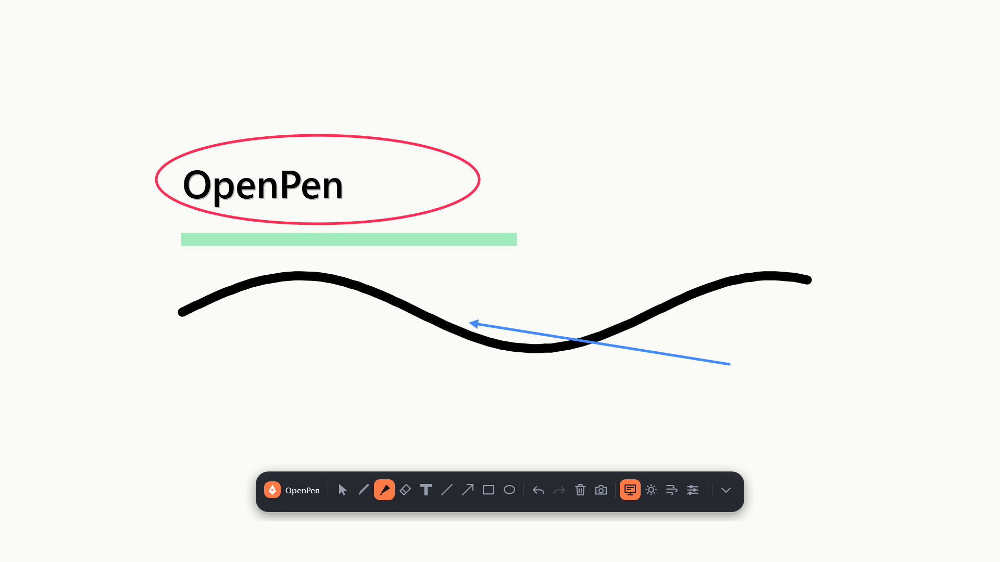

# OpenPen

**Draw on your Windows screen, over anything.** A native, local-first annotation app for
presentations, teaching, demos, calls and screen recordings.

[](#requirements)
[](#builds)
[](LICENSE)
[](#privacy)

OpenPen is an independent remake of the idea behind [Epic Pen](https://epicpen.com/).
It is not affiliated with Epic Pen or Tank Studios, and none of their code or assets are used.

- **Native Windows app** — C#, WPF and Win32. No browser, no Electron, no web server.
- **Main executable:** `OpenPen.exe`
- **Free and open source** — MIT.
- **No telemetry** — no accounts, no ads, no analytics, and no network requests at all.

<p align="center">
  
  <br>
  <sub>The compact one-row toolbar. Use the chevron on the right for colors, tool size, and opacity.</sub>
</p>

---

## What it does

OpenPen puts a transparent ink layer over your whole desktop. You keep using the apps
underneath; your ink stays on screen until you clear it.

- Compact one-row toolbar with an expander chevron for colors and size
- Pen with pen-pressure support
- Highlighter with translucent ink
- Partial eraser (splits strokes instead of deleting whole lines)
- Text anywhere on screen
- Straight lines, arrows, rectangles and ellipses
- 16 quick colors plus a custom color picker with RGB and hex input
- Adjustable ink opacity for new strokes
- Per-tool sizes, changed with the toolbar, `[` / `]`, or the mouse wheel
- Undo / redo and clear
- Whiteboard and blackboard modes
- Spotlight cursor
- Fading ink (20 s / 10 s / 5 s)
- Pass-through mode so clicks reach the app underneath while the ink stays visible
- Hide the toolbar and keep drawing with hotkeys (“ghost mode”)
- Screenshot with your ink burned in — copied to the clipboard and saved as PNG
- Multi-monitor overlays with per-monitor DPI awareness
- Tray icon, global hotkeys, Start with Windows
- Right-click the OpenPen wordmark for quick Hide / Settings / Close
- Fully local: settings live in `%AppData%\OpenPen`

## Requirements

- Windows 10 or Windows 11, x64
- Mouse, touchscreen, pen tablet or interactive display
- .NET 8 Desktop Runtime for the portable build, or the .NET 8 SDK to build from source

## Run it

From the repository root:

```powershell
dotnet run --project OpenPen.csproj
```

Or build and launch the exe:

```powershell
dotnet build OpenPen.sln -c Release
.\bin\Release\net8.0-windows\win-x64\OpenPen.exe
```

OpenPen starts in **pass-through** mode with the toolbar collapsed to a single row.
Pick a tool from the toolbar or press `Ctrl+Shift+3` for the pen. The chevron on the
right expands the bar for colors, tool size, ink opacity, ink visibility, and the hide button.
Everything is controlled by the floating toolbar, the tray icon, the logo's right-click
menu, or the shortcuts below.

Hiding the toolbar only lasts for the current session. Every fresh launch shows it again.

## Builds

There are two variants of the same app:

| Variant | Command | Runtime needed | Typical size |
| --- | --- | --- | --- |
| **Slim** (framework-dependent) | `.\build.ps1` | .NET 8 Desktop Runtime (x64) | ~0.4 MB |
| **Standalone** (self-contained) | `.\build.ps1 -SelfContained` | None | ~140 MB |

Both default to `dist\OpenPen\OpenPen.exe`. To keep both builds side by side:

```powershell
.\build.ps1 -Output dist\OpenPen-slim
.\build.ps1 -SelfContained -Output dist\OpenPen-standalone
```

When distributing them, a clear naming scheme is `OpenPen.exe` for the standalone build
and `OpenPen-Net8.exe` for the slim build.

There is no binary checked into the repository. GitHub Actions builds and uploads a
portable x64 artifact on every push and pull request (`.github/workflows/build.yml`).

## Default shortcuts

All shortcuts are global, so they work while another app is full screen.

| Shortcut | Action |
| --- | --- |
| `Ctrl+Shift+1` | Show / hide ink |
| `Ctrl+Shift+2` | Spotlight cursor |
| `Ctrl+Shift+3` | Pen |
| `Ctrl+Shift+4` | Highlighter |
| `Ctrl+Shift+5` | Eraser |
| `Ctrl+Shift+6` | Undo |
| `Ctrl+Shift+7` | Clear all ink |
| `Ctrl+Shift+8` | Pass clicks through |
| `Ctrl+Shift+9` | Swap to previous color |
| `Ctrl+Shift+0` | Show / hide the toolbar |
| `Ctrl+Shift+,` | Screenshot to clipboard |
| `Ctrl+Shift+[` / `]` | Smaller / larger tool |
| `Ctrl+Shift+L` | Line |
| `Ctrl+Shift+A` | Arrow |
| `Ctrl+Shift+R` | Rectangle |
| `Ctrl+Shift+E` | Ellipse |
| `Ctrl+Shift+T` | Text |
| `Ctrl+Shift+W` | Whiteboard |
| `Ctrl+Shift+B` | Blackboard |
| `Ctrl+Shift+F` | Fading ink on / off |
| `Ctrl+Shift+Z` | Redo |
| `Ctrl+Alt+1` … `Ctrl+Alt+6` | Quick color slots |

The toolbar's **gear** opens settings, the shortcuts list, Start with Windows, fading
speed, spotlight size, toolbar reset, and the About panel.

## How it works

- OpenPen creates one transparent, topmost, non-activating WPF window per monitor.
- Strokes are stored in virtual-desktop **physical pixels**, so a stroke drawn across
  monitors is rendered correctly on each one.
- Each overlay converts physical points into its own DPI-aware local coordinates. Pen
  widths stay in device-independent units.
- A few important desktop-composition details:
  - Every overlay is `WS_EX_NOACTIVATE`, so drawing never steals keyboard focus from the
    app underneath.
  - In pass-through mode the overlay is `WS_EX_TRANSPARENT`.
  - In drawing mode the overlay is painted with 1/255 alpha. Windows hit-tests layered
    windows by alpha, so a fully transparent overlay would let every click fall through;
    1/255 is invisible but solid to the mouse.
  - A lightweight z-order guard keeps the toolbar above the ink layer, including opaque
    whiteboard mode.
- Ink is rendered as vector geometry (variable-width ribbons for pen strokes), not
  screenshots, so it stays crisp at any DPI. Text uses `FormattedText`; shapes use
  WPF geometry.
- Undo/redo uses small snapshot lists of completed strokes. The eraser splits a stroke
  into the pieces that survive, and one undo restores the whole gesture.
- The screenshot hides the toolbar, captures the composited desktop with GDI, copies it
  to the clipboard and saves a PNG under `Pictures\OpenPen`.

## Privacy

OpenPen does not contain telemetry, analytics, crash reporting, ads, accounts, update
checks, or any networking code. The only things it writes are:

- `%AppData%\OpenPen\settings.json` — preferences
- `%AppData%\OpenPen\openpen.log` — local crash log, only if something goes wrong
- `Pictures\OpenPen\*.png` — screenshots you explicitly take

Ink is kept in memory and disappears when the app exits, which is intentional.

## Known limitations

- Global shortcuts are fixed in this build. They match Epic Pen's familiar layout.
- Ink is not persisted between sessions.
- The eraser removes parts of strokes rather than individual pixels.
- Text is single-run and does not word-wrap; use `Shift+Enter` for line breaks.
- Multi-monitor works, but mixing monitors with very different DPI scales has only been
  designed for per-monitor-v2 Windows, not exhaustively tested on every hardware combo.
- No cloud, no sharing, no OCR, no accounts. This is a small local tool.

## Project layout

```
.
├── App.xaml / App.xaml.cs        WPF resources, theme and app lifetime
├── Models/                       tools, strokes, fade math
├── Controls/InkSurface.cs        per-monitor drawing surface and input
├── Rendering/InkRenderer.cs      vector stroke, shape and text rendering
├── Services/
│   ├── AppController.cs          modes, commands, timers, screenshot
│   ├── InkDocument.cs            stroke list and snapshot undo/redo
│   ├── HotkeyService.cs          RegisterHotKey + message-only sink
│   ├── OverlayManager.cs         one overlay window per monitor
│   ├── TrayService.cs            tray icon and dark context menu
│   ├── AppSettings.cs            local JSON preferences
│   ├── ScreenshotService.cs      GDI capture, clipboard, PNG
│   └── ...
├── Views/                        toolbar, settings, color picker, text entry, toast
├── Interop/NativeMethods.cs      small Win32 surface
├── Assets/openpen.ico            app + tray icon
├── docs/screenshot.png           README screenshot
├── tools/make-icon.ps1           reproducible icon generator
├── .github/workflows/build.yml   Windows CI build
├── build.ps1
├── CONTRIBUTING.md
├── SECURITY.md
├── CHANGELOG.md
├── LICENSE
└── README.md
```

## Contributing

Issues and pull requests are welcome. Please read [CONTRIBUTING.md](CONTRIBUTING.md).
The short version: keep OpenPen local, keep it native, and do not add telemetry,
accounts, ads, or network code.

## Security

OpenPen runs entirely on your machine and has no network code. For security reports,
please follow [SECURITY.md](SECURITY.md) instead of opening a public issue.

## License

MIT © 2026 OpenPen contributors. See [LICENSE](LICENSE).

---

<sub>Built with C#, WPF, Win32 and an unreasonable dislike of hidden telemetry.</sub>
